# Eudemia

A **gamified learning webapp** that gamifies education. With points, leaderboards, challenges, and progress tracking for students, teachers, and parents.


## Table of Contents

- [About](#about)
- [Features](#features)
- [Tech Stack](#tech-stack)
- [Screenshots](#screenshots)
  - [General & Profile Pages](#general--profile-pages)
  - [Student View](#student-view)
  - [Teacher View](#teacher-view)
  - [Parent View](#parent-view)
- [Installation & Setup](#installation--setup)
- [Folder Structure](#folder-structure)

## About

**Eudemia** is a gamified education platform built to make learning more interactive and motivating for students while giving teachers and parents useful tools for monitoring and engagement.

## Features

- **Gamified Learning:** Students earn points, complete challenges, and appear on leaderboards.
- **Multi-Role System:** Separate students, teachers and parents dashbards.
- **Progress Tracking:** Visually track challenges completion.
- **Health Monitoring:** Teachers and parents can track students health.
- **In-App Shop:** Use points to customize your profile.
- **Profile Management:** Change password, edit profile, and upload profile pictures.
- **Responsive UI:** Works seamlessly on desktop and mobile.

## Tech Stack

- **Backend:** Python (Django)
- **Frontend:** HTML, CSS, JavaScript, Django Templates
- **Database:** SQLite / PostgreSQL (configurable)

## Screenshots

Below are screenshots of the Eudemia web app, grouped by user role and feature area.

### General & Profile Pages

| Home                          | Login                           |
| ----------------------------- | ------------------------------- |
| 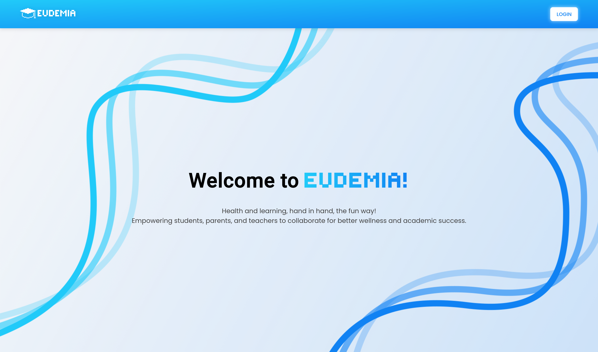 | 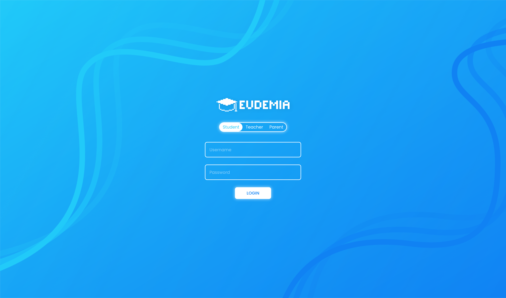 |

| Change Profile                                    | Change Password                                     | Leaderboard                                 |
| ------------------------------------------------- | --------------------------------------------------- | ------------------------------------------- |
| 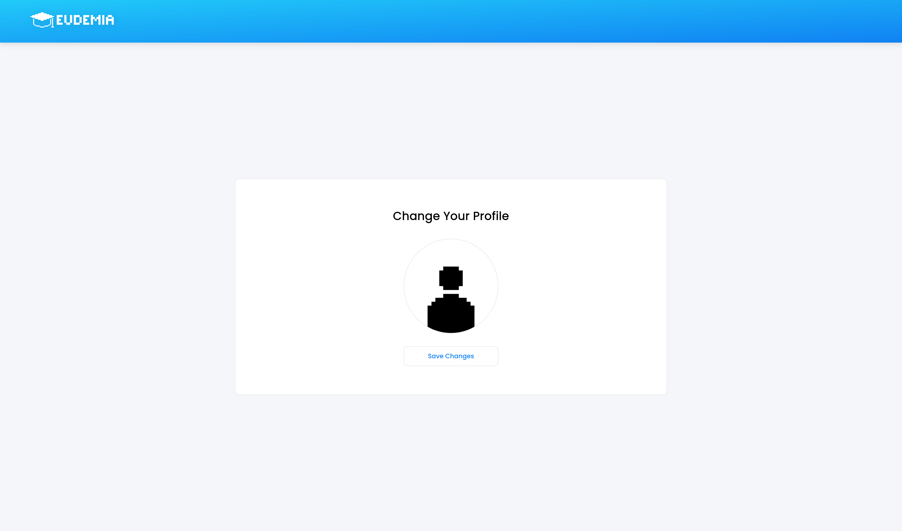 | 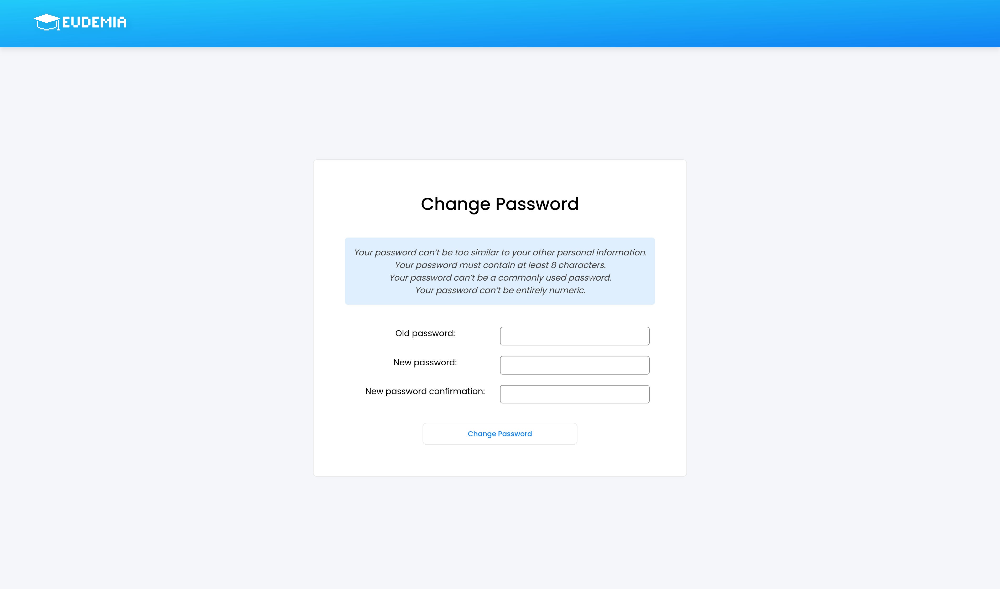 | 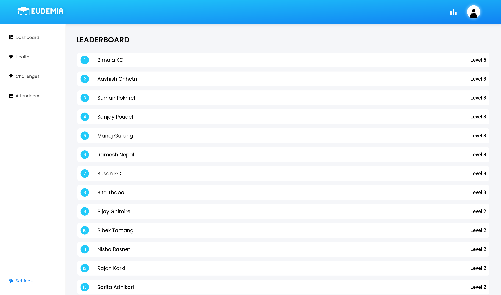 |

### Student View

| Dashboard                                                 | Health                                              | Challenges                                                  |
| --------------------------------------------------------- | --------------------------------------------------- | ----------------------------------------------------------- |
| 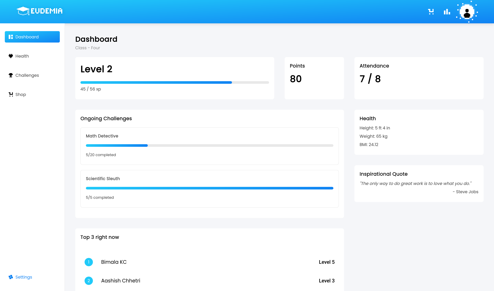 | 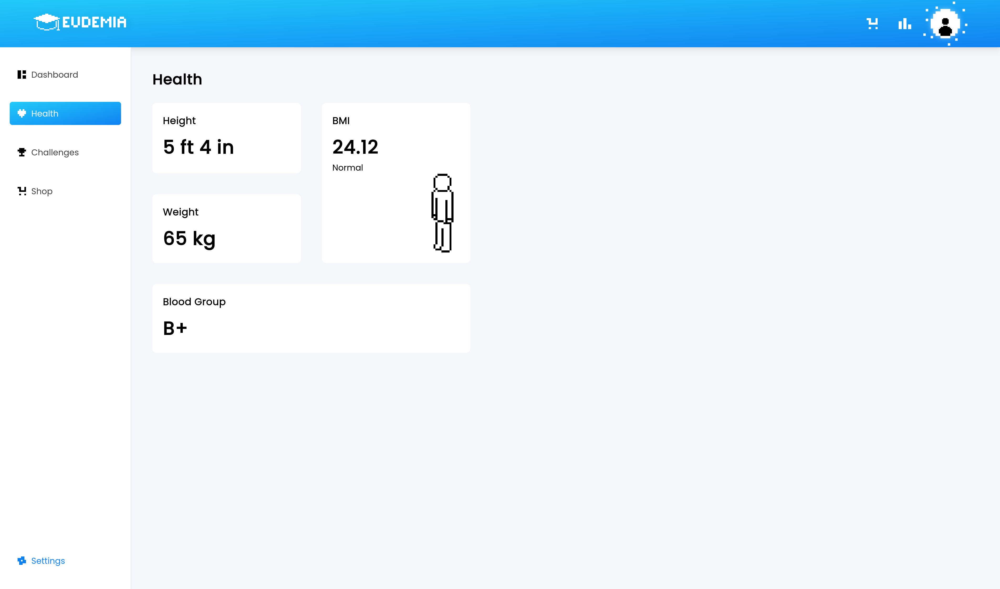 | 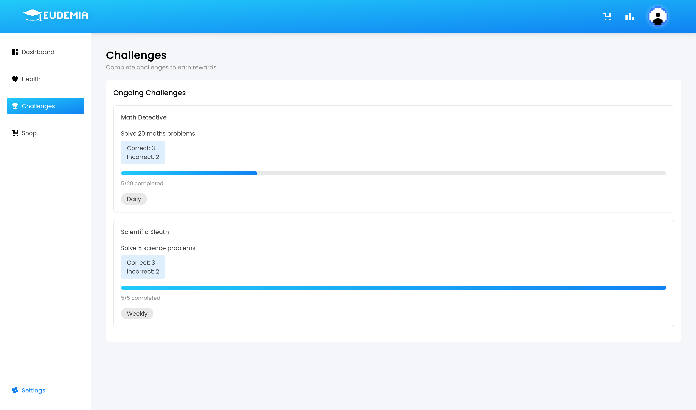 |

| Shop                          | Customization                                                     |
| ----------------------------- | ----------------------------------------------------------------- |
| 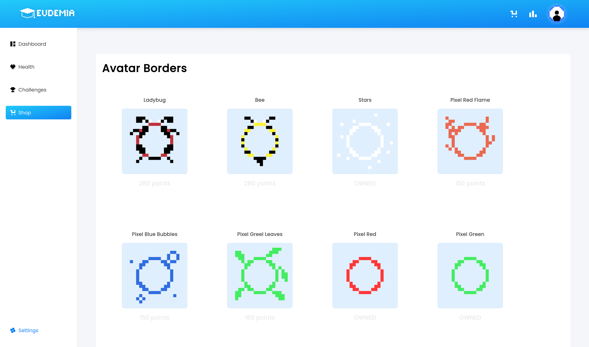 | 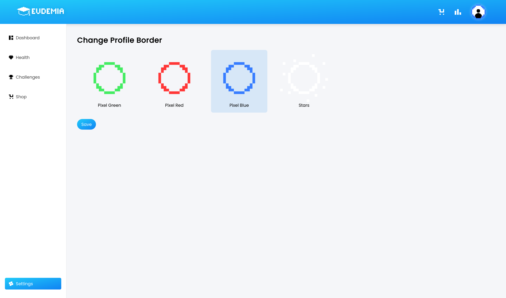 |

### Teacher View

| Dashboard                                                           | Health                                              | Challenges                                                  | Attendance                                                  |
| ------------------------------------------------------------------- | --------------------------------------------------- | ----------------------------------------------------------- | ----------------------------------------------------------- |
| 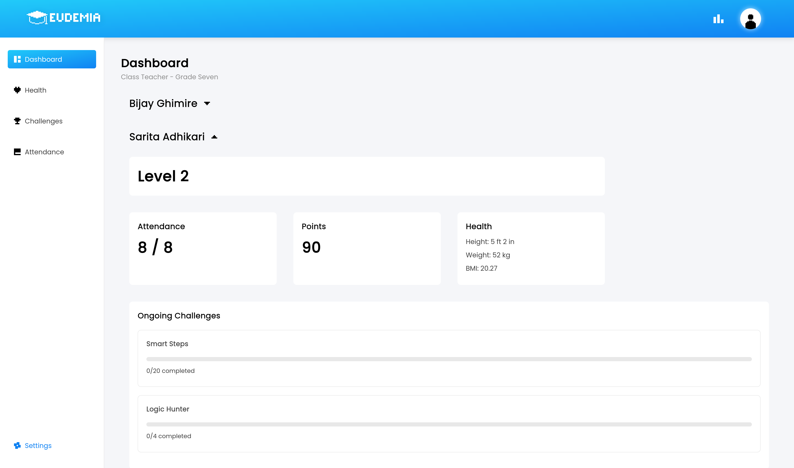 | 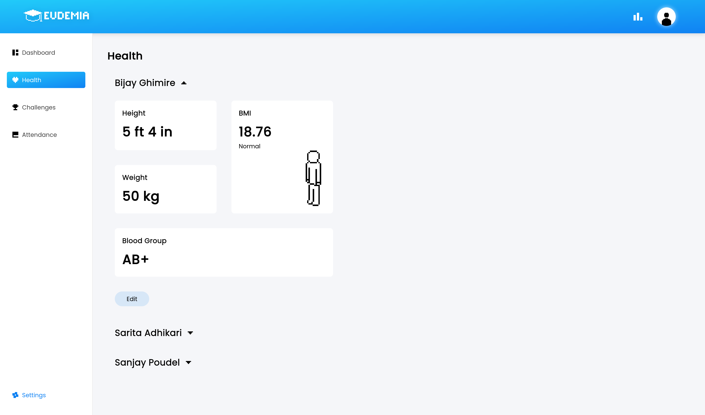 | 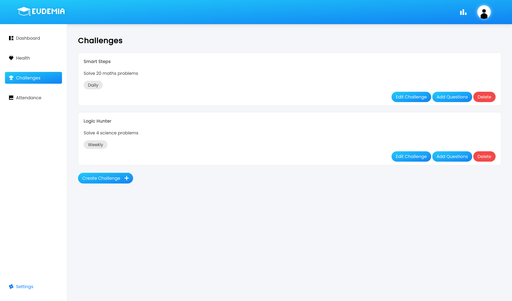 | 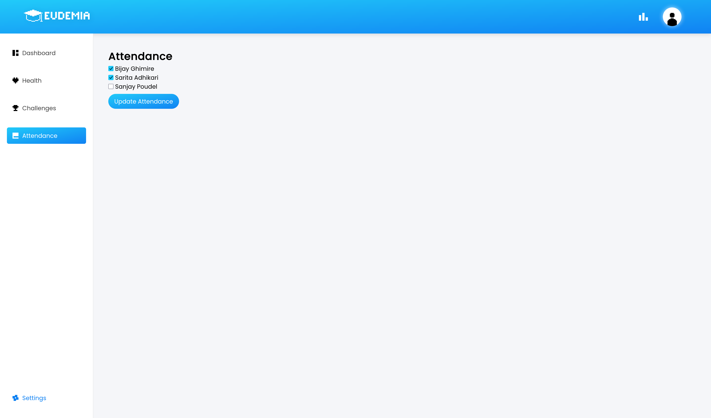 |

### Parent View

| Dashboard                                               | Health                                            | Progress Tracking                                     | 
| ------------------------------------------------------- | ------------------------------------------------- | ----------------------------------------------------- | 
| 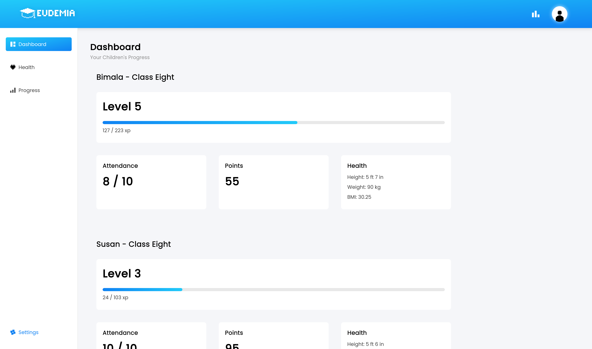 | 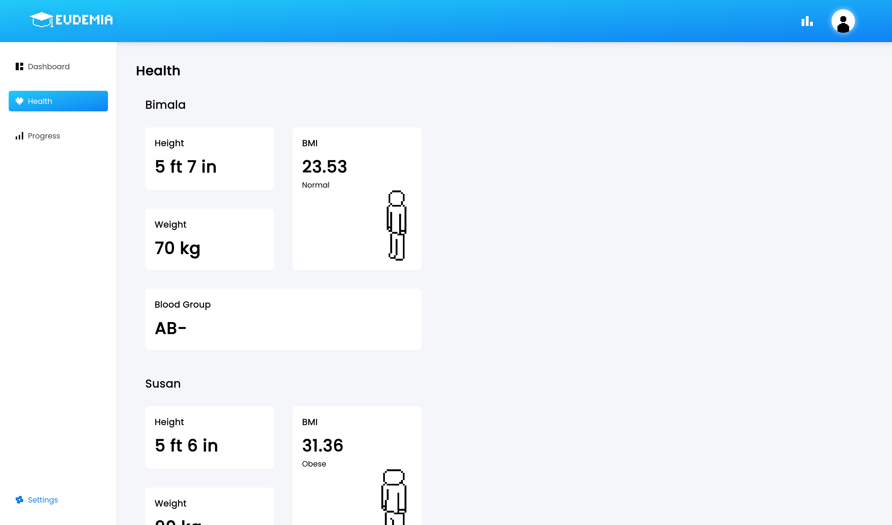 | 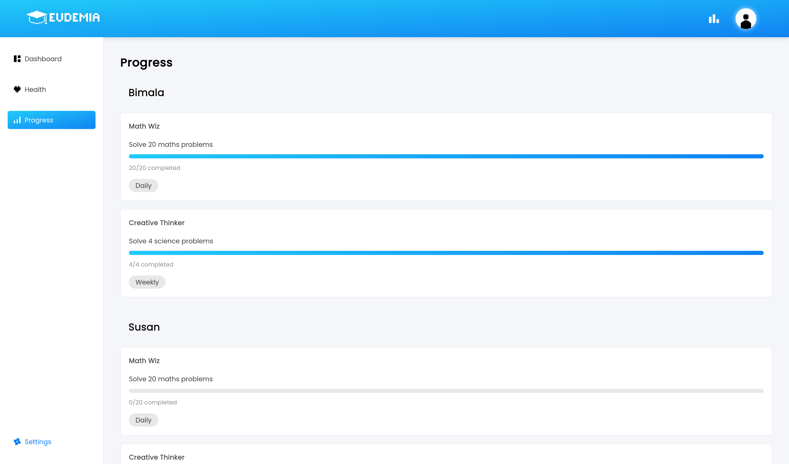 | 

## Installation & Setup

1. **Clone the repository**

   ```bash
   git clone https://github.com/rasum13/eudemia.git
   cd eudemia
   ```

2. **Create and activate a virtual environment**

   ```bash
   python3 -m venv venv
   source venv/bin/activate
   ```

3. **Install dependencies**

   ```bash
   pip install -r requirements.txt
   ```

4. **Apply migrations**

   ```bash
   python manage.py migrate
   ```

5. **Run the development server**

   ```bash
   python manage.py runserver
   ```

6. Visit `http://127.0.0.1:8000/` in your browser.

## Folder Structure

```
eudemia/
├─ api/
├─ users/
├─ templates/
├─ static/
├─ media/
│   └─ profile_pictures/
├─ screenshots/
├─ manage.py
├─ requirements.txt
├─ passenger_wsgi.py
└─ .gitignore
```
